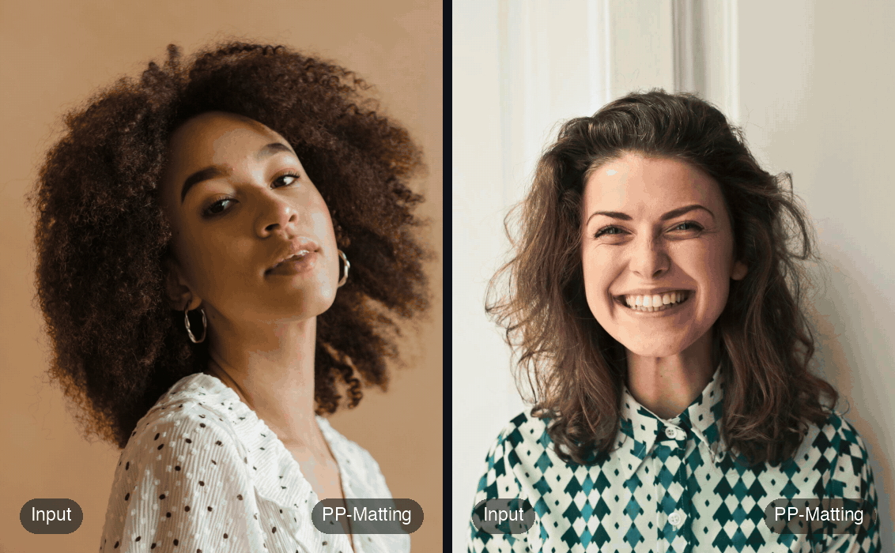
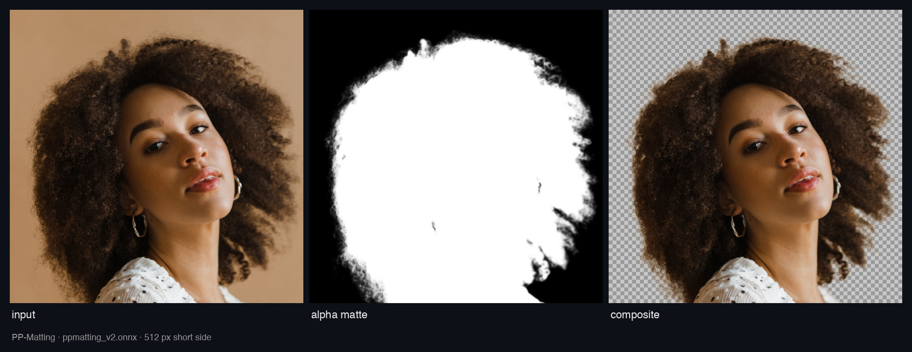
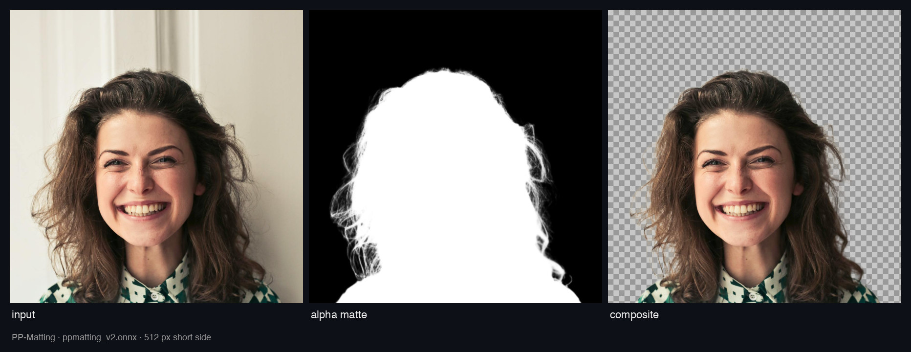

# PP-Matting: Portrait Matting in PyTorch and ONNX

[](https://github.com/yakhyo/ppmatting/releases) [](LICENSE)

> [!TIP]
> The models in this repository are **integrated into [UniFace](https://github.com/yakhyo/uniface)**, an all-in-one face analysis toolkit.
> [](https://pypi.org/project/uniface/) [](https://github.com/yakhyo/uniface/stargazers)

PyTorch and ONNX Runtime inference for the [PaddleSeg](https://github.com/PaddlePaddle/PaddleSeg/tree/release/2.10/Matting) portrait matting models ([PP-Matting paper](https://arxiv.org/abs/2204.09433)). Works on images, videos and webcam feeds.

<p align="center">
  
</p>

<p align="center">
  
  
</p>

Mattes predicted by `ppmatting_v2.onnx`. Photos from [UniFace&#39;s demo set](https://github.com/yakhyo/uniface/blob/main/assets/demo/README.md).

## Models

PyTorch checkpoints and the ONNX exports built from them. Download via `bash download.sh` or from [Releases](https://github.com/yakhyo/ppmatting/releases/tag/weights).

| Model        | Backbone  | Params | SAD   | PyTorch                                                                            | ONNX                                                                                   |
| ------------ | --------- | ------ | ----- | ---------------------------------------------------------------------------------- | -------------------------------------------------------------------------------------- |
| PP-MattingV2 | STDC1     | 8.95M  | 40.59 | [pt](https://github.com/yakhyo/ppmatting/releases/download/weights/ppmatting_v2.pt) | [onnx](https://github.com/yakhyo/ppmatting/releases/download/weights/ppmatting_v2.onnx) |
| PP-Matting   | HRNet-W18 | 24.5M  | 31.56 | [pt](https://github.com/yakhyo/ppmatting/releases/download/weights/ppmatting_v1.pt) | [onnx](https://github.com/yakhyo/ppmatting/releases/download/weights/ppmatting_v1.onnx) |

The weights are PaddleSeg's released `human_512` weights converted to PyTorch, and the ONNX files reproduce PaddleSeg's published scores. PP-MattingV2 is the fast one, PP-Matting the accurate one (SAD on PPM-AIM-195, lower is better). Both take an RGB image in `[-1, 1]` with sides that are multiples of 32 and return an alpha matte in `[0, 1]`; the scripts handle the resizing.

## Installation

```bash
pip install -r requirements.txt
bash download.sh  # Download model weights
```

## Usage

### CLI

```bash
# PyTorch
python main.py --source assets/inputs/src_img1.jpg --output results/
python main.py --source video.mp4 --model ppmatting_v1 --background bg.jpg --output out.mp4
python main.py --source 0

# ONNX Runtime
python onnx_inference.py --source assets/inputs/src_img1.jpg --weights weights/ppmatting_v2.onnx --output results/
python onnx_inference.py --source video.mp4 --weights weights/ppmatting_v1.onnx --background bg.jpg --output out.mp4
python onnx_inference.py --source 0 --weights weights/ppmatting_v2.onnx
```

An image gives the matte, a green-screen composite and an RGBA cutout. A video or webcam feed is composited over `--background`, or over green.

### Python API

```python
import cv2
from model import PPMattingONNX

model = PPMattingONNX('weights/ppmatting_v2.onnx')
alpha = model.predict(cv2.imread('assets/inputs/src_img1.jpg'))  # (H, W) float32 in [0, 1]
```

## Exporting Your Own Weights

`onnx_export.py` converts a `.pt` checkpoint to ONNX with dynamic batch, height and width.

```bash
python onnx_export.py --model ppmatting_v2 --simplify
python onnx_export.py --model ppmatting_v1 --simplify
```

## Reference

- [PaddleSeg Matting](https://github.com/PaddlePaddle/PaddleSeg/tree/release/2.10/Matting), the original implementation and weights.
- [UniFace](https://github.com/yakhyo/uniface), face analysis toolkit that ships these models.

## License

[Apache License 2.0](LICENSE)
